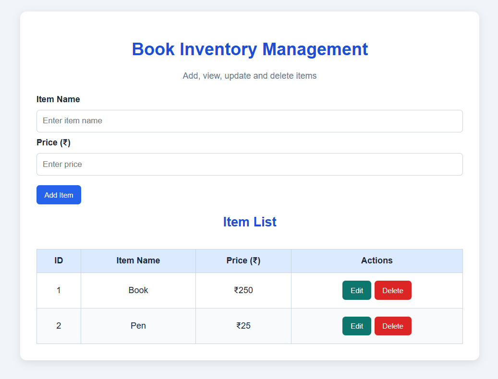
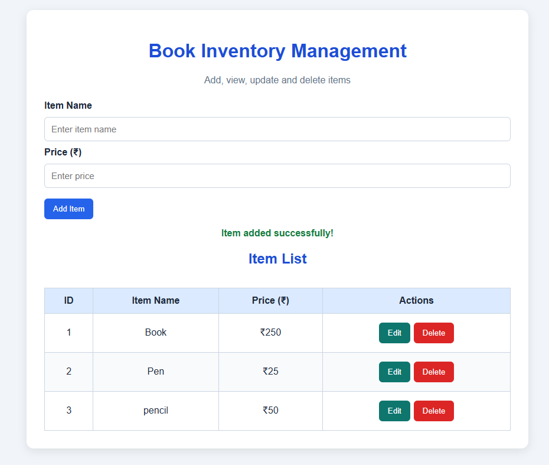
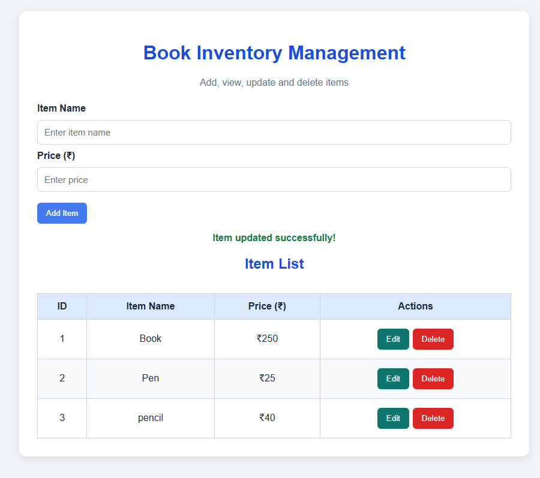
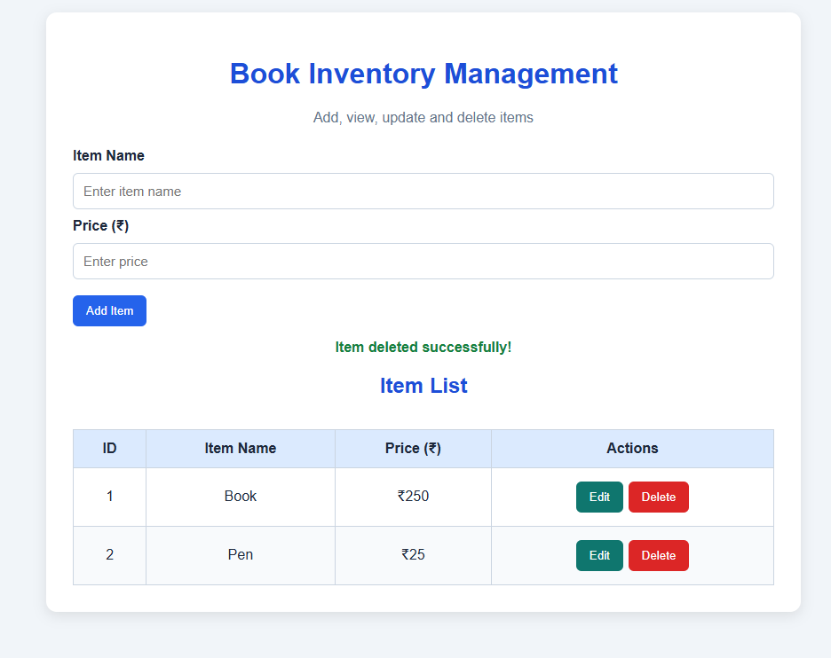

# Task 1: Book CRUD Application

## Aim
To develop a Book Management application using HTML, CSS, JavaScript, Node.js, Express.js, and REST APIs.

## Features
- **Add:** Add a new book.
- **View:** Display all books.
- **Update:** Edit existing book details.
- **Delete:** Remove a book.

## Technologies Used
- HTML
- CSS
- JavaScript
- Node.js
- Express.js
- REST API

## How to Run
1. Install Node.js.
2. Open the project folder in VS Code.
3. Open the terminal and run:

   `npm install express`

4. Start the server:

   `node server6.js`

5. Open `http://localhost:3000` in your browser.

## Output Screenshots

### Initial Output

### Add Book

### Update Book

### Delete Book

